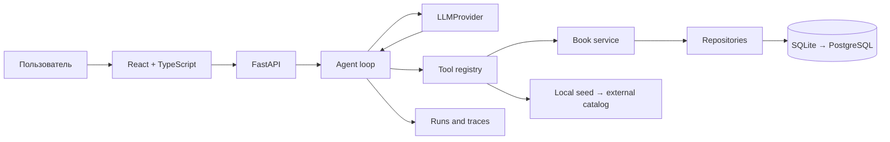

# Book Agent

Учебный проект для последовательного изучения AI-агентов на примере личной библиотеки книг.

Пользователь сможет попросить агента найти книгу, посмотреть библиотеку, изменить статус чтения или подобрать следующую книгу. Модель при этом не получает прямой доступ к базе данных: она выбирает доступные инструменты, а backend валидирует и безопасно выполняет каждый вызов.

> **Статус:** этап 4 завершён — реализованы LLM-адаптер, строгие tools, управляемый agent loop, защиты от циклов, сохранение трейса в SQLite и синхронный HTTP endpoint. Следующий шаг — многошаговые задачи из [этапа 5](./ROADMAP.md#этап-5-многошаговые-задачи-и-состояние).

## Зачем нужен этот проект

Цель проекта — не собрать максимально сложного или автономного агента, а самостоятельно пройти весь путь от обычного backend-приложения до контролируемой агентной системы.

В ходе работы будут последовательно реализованы:

- agent loop;
- function/tool calling;
- строгие схемы входов и результатов;
- многошаговое выполнение задач;
- состояние запусков и защита от циклов;
- human-in-the-loop для подтверждения действий;
- память и RAG по пользовательским заметкам;
- evals;
- логи и трассировка запусков.

Подробная учебная программа находится в [ROADMAP.md](./ROADMAP.md).

## MVP-сценарии

Первая законченная версия должна поддерживать четыре сценария:

1. **Посмотреть текущие книги**

   > Покажи книги, которые я сейчас читаю.

2. **Найти и добавить книгу**

   > Найди «Дюну» и добавь её в список «Хочу прочитать».

3. **Изменить статус чтения**

   > Я дочитал «1984». Отметь её как прочитанную.

4. **Выполнить многошаговую рекомендацию**

   > Посмотри, что я недавно прочитал, и предложи три похожие книги, которых ещё нет в моей библиотеке.

Успех определяется не красотой ответа модели, а итоговым состоянием системы: нужная книга найдена, запись изменена ровно один раз, дубликаты исключены, запрещённые действия не выполнялись.

## Что делает систему агентом

Обычный LLM-чат получает текст и возвращает текст. В этом проекте модель включена в управляемый цикл:

1. пользователь формулирует цель;
2. модель решает, нужен ли инструмент;
3. backend проверяет имя инструмента и его аргументы;
4. инструмент выполняет ограниченное действие;
5. результат возвращается модели;
6. модель выбирает следующий шаг или формирует финальный ответ;
7. backend останавливает цикл по результату, ошибке, ожиданию подтверждения или лимиту шагов.

Модель предлагает действия, но не исполняет их самостоятельно. Контроль, доступ к данным, правила безопасности и критерии остановки принадлежат приложению.

## Архитектура



Основные границы системы:

- React общается только с HTTP API;
- agent loop зависит от контракта `LLMProvider`, а не от SDK конкретного провайдера;
- модель видит только опубликованные определения инструментов;
- инструменты вызывают доменные сервисы, но не содержат произвольный SQL;
- доменная логика книг работает и без LLM;
- трейс запуска хранится отдельно от пользовательского ответа.

## Основные контракты

Это упрощённое представление текущих интерфейсов без деталей валидации.

```python
class LLMProvider(Protocol):
    def generate(
        self,
        messages: list[Message],
        tools: list[ToolDefinition],
    ) -> ModelResponse: ...
```

`LLMProvider` описывает только возможности, которые действительно нужны agent loop. Параметры конкретного API — идентификатор предыдущего ответа, reasoning-настройки, usage и сырые события — преобразуются внутри адаптера и не протекают в доменный слой.

```python
@dataclass(frozen=True)
class ToolDefinition:
    name: str
    description: str
    access: ToolAccess
    arguments_model: type[BaseModel]
    result_model: type[BaseModel]

class ToolCall(BaseModel):
    id: str
    name: str
    arguments: dict[str, object]

class ToolResult(BaseModel):
    tool_call_id: str
    tool_name: str
    output: dict[str, object] | None = None
    error: ToolError | None = None
```

Планируемые инструменты MVP:

| Инструмент | Назначение | Тип |
| --- | --- | --- |
| `search_books` | Найти книги в каталоге | read |
| `get_user_library` | Получить библиотеку с фильтром по статусу | read |
| `add_book` | Добавить книгу в библиотеку | write |
| `update_book_status` | Изменить статус существующей книги | write |

Реализованные состояния `AgentRun`:

- `running`;
- `completed`;
- `failed`;
- `step_limit_exceeded`.

Состояние `waiting_for_approval` появится вместе с подтверждением действий на этапе 6.

Каждый `AgentStep` соответствует одному обращению к модели и хранит номер шага, снимок истории сообщений, нормализованный ответ, результаты tools, ошибку и длительность.

## Стек

### Backend

- Python;
- FastAPI;
- Pydantic;
- SQLAlchemy;
- Alembic;
- SQLite на первых этапах;
- PostgreSQL после стабилизации доменных контрактов;
- pytest.

### Frontend

- React;
- TypeScript;
- Vite;
- Vitest.

### Интеграции

- локальный детерминированный каталог книг на старте;
- внешний каталог, например Open Library, на отдельном этапе;
- провайдер-независимый `LLMProvider`;
- DeepSeek Chat Completions как первая реальная реализация адаптера;
- fake-провайдер для unit-тестов.

## Будущая структура проекта

Каталоги создаются только тогда, когда становятся нужны. Это карта предполагаемых границ, а не требование заранее сгенерировать пустой каркас.

```text
book-agent/
├── backend/
│   ├── app/
│   │   ├── api/             # HTTP endpoints и DTO
│   │   ├── agent/           # loop, state, policies
│   │   ├── llm/             # контракт и адаптеры провайдеров
│   │   ├── tools/           # registry и определения tools
│   │   ├── books/           # доменные модели и сервисы
│   │   ├── repositories/    # SQLite/PostgreSQL реализации
│   │   └── observability/   # runs, steps, tracing
│   ├── migrations/
│   └── tests/
├── frontend/
│   └── src/
│       ├── api/
│       ├── features/chat/
│       ├── features/approvals/
│       └── features/runs/
├── evals/
│   ├── datasets/
│   └── runners/
├── README.md
└── ROADMAP.md
```

## Как работать с роадмапом

1. Проходить этапы по порядку, не привязываясь к календарю.
2. Перед реализацией прочитать блок «Что понять» и своими словами сформулировать поток данных.
3. Реализовать только перечисленный вертикальный сценарий.
4. Добавить позитивные тесты и минимум один негативный тест.
5. Проверить критерии готовности и ответить на вопросы для самопроверки.
6. Записать выводы прямо в `ROADMAP.md` или в сообщение отдельного commit.
7. Сделать небольшой commit, который относится только к завершённому этапу.

Не переходите дальше, если сценарий работает только при ручном разговоре с моделью, но не имеет автоматической проверки результата.

## Запуск

Для backend нужны Python 3.12 и [uv](https://docs.astral.sh/uv/). Команды выполняются из корня проекта.

### Backend

```bash
cd backend
uv sync
cp .env.example .env
uv run alembic upgrade head
uv run python -m app.seed
uv run uvicorn app.main:app --reload
```

API будет доступен на `http://localhost:8000`, интерактивная схема — на `http://localhost:8000/docs`.

Синхронный запуск агента:

```bash
curl -X POST http://localhost:8000/api/agent/runs \
  -H 'Content-Type: application/json' \
  -d '{"message":"Найди Дюну и добавь в список на чтение"}'
```

Endpoint возвращает финальное состояние `AgentRun` и упорядоченный трейс шагов. Максимальное число обращений к модели задаётся через `AGENT_MAX_STEPS` и по умолчанию равно `5`.

### Frontend

Frontend появится на этапе 7; команды ниже пока являются целевым интерфейсом и ожидаемо не работают.

```bash
cd frontend
npm install
npm run dev
```

Планируемый адрес интерфейса: `http://localhost:5173`.

### Тесты

```bash
cd backend
uv run pytest
```

Тесты не используют LLM или внешнюю сеть.

## Границы первой версии

До завершения базового agent loop намеренно не используются:

- LangChain, LangGraph, CrewAI и другие агентные фреймворки;
- несколько взаимодействующих агентов;
- MCP;
- browser или computer automation;
- автономные фоновые задачи на часы;
- сложный planner;
- векторная база «для всей памяти»;
- self-reflection после каждого шага;
- автоматическое переписывание собственных промптов.

После финальной ревизии можно осознанно сравнить самописный harness с Agents SDK или графовым фреймворком. К этому моменту будет понятно, какую реальную проблему должен решить новый слой абстракции.

## Уровни готовности

- **Backend MVP — этапы 1–5:** четыре сценария выполняются через API, результаты проверяются по состоянию БД.
- **Безопасный MVP — этап 6:** запись или опасное действие можно остановить и подтвердить без повторного исполнения.
- **Пользовательский MVP — этап 7:** сценарии доступны через React-интерфейс.
- **Расширенная версия — этапы 8–10:** внешний каталог, PostgreSQL, RAG, evals и полная трассировка.

Таким образом, внешний каталог, PostgreSQL и RAG не блокируют первую законченную версию.

## Полезные материалы

Проект остаётся провайдер-независимым. Эти ссылки нужны для реализации первого OpenAI-адаптера и понимания общих паттернов:

- [Responses API: руководство по переходу и ключевым концепциям](https://developers.openai.com/api/docs/guides/migrate-to-responses)
- [Function calling](https://developers.openai.com/api/docs/guides/function-calling)
- [Structured outputs](https://developers.openai.com/api/docs/guides/structured-outputs)
- [Построение агентов](https://developers.openai.com/api/docs/guides/agents)
- [Evals](https://developers.openai.com/api/docs/guides/evals)
- [OpenAI developer resources: learning track по агентам](https://developers.openai.com/resources)

Документация API меняется. Перед реализацией конкретного адаптера следует повторно проверить актуальную схему официального SDK и endpoint, не перенося провайдерские детали в общий контракт.

## Главный учебный принцип

Качество агента определяется не только моделью. Надёжность создают строгие инструменты, ограниченный цикл, проверяемое состояние, approvals, идемпотентность, тесты и наблюдаемость. Именно эту систему вокруг модели и предстоит построить.
